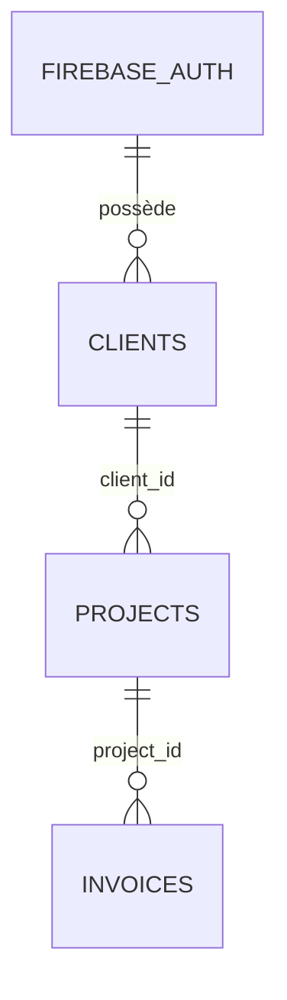

# FreelanceDesk

FreelanceDesk permet à un freelance de gérer ses clients, ses projets et ses factures dans un espace personnel. Le tableau de bord présente les projets en cours, les montants encaissés et à encaisser, ainsi que les factures en retard.

L’application utilise Next.js App Router, React, TypeScript, Tailwind CSS, Lucide React, Firebase Authentication et Cloud Firestore. Git suit les sources et le fichier de verrouillage npm.

## Installation et lancement

Node.js 24 et npm sont requis. Depuis la racine du projet, installe les dépendances avec `npm ci` et prépare la configuration à partir de `.env.example` si `.env.local` est absent.

```sh
npm ci
cp -n .env.example .env.local
npm run dev
```

L’application de développement est disponible à l’adresse `http://localhost:3000`. Pour lancer localement la version de production, utilise `npm run build`, puis `npm start`. Le build utilise webpack. Le serveur de développement utilise Turbopack par défaut.

### Variables d’environnement

| Variable | Valeur |
|---|---|
| `NEXT_PUBLIC_FIREBASE_API_KEY` | Clé API de l’application Web Firebase |
| `NEXT_PUBLIC_FIREBASE_AUTH_DOMAIN` | Domaine Auth de l’application Web |
| `NEXT_PUBLIC_FIREBASE_PROJECT_ID` | Identifiant du projet Firebase |
| `NEXT_PUBLIC_FIREBASE_STORAGE_BUCKET` | Bucket fourni par la configuration Web, facultatif pour FreelanceDesk |
| `NEXT_PUBLIC_FIREBASE_MESSAGING_SENDER_ID` | Identifiant d’expéditeur de la configuration Web, facultatif pour FreelanceDesk |
| `NEXT_PUBLIC_FIREBASE_APP_ID` | Identifiant de l’application Web |
| `FIREBASE_PROJECT_ID` | Identifiant du projet côté serveur, identique à celui du SDK Web |
| `GOOGLE_APPLICATION_CREDENTIALS` | Si nécessaire, chemin absolu vers les identifiants Admin stockés hors dépôt |

Les variables `NEXT_PUBLIC_` sont incorporées au code livré au navigateur. Le projet charge les identifiants Admin uniquement côté serveur, via les identifiants applicatifs par défaut de Google (ADC). Sur un hébergement Google Cloud, privilégie l’identité du service d’exécution. En local, si tu utilises un fichier de clé d’un compte de service créé dans **Google Cloud → IAM et administration → Comptes de service**, garde le fichier hors du dépôt et indique son chemin absolu dans `.env.local`. [Configuration de l’Admin SDK](https://firebase.google.com/docs/admin/setup)

Pour l’identité serveur, le rôle `roles/datastore.user` couvre les lectures et écritures Firestore. Le rôle `roles/firebaseauth.viewer` couvre la lecture des comptes Firebase Authentication lors de la vérification de la révocation des jetons. Les comptes qui lancent le déploiement des règles peuvent utiliser des droits distincts. [Rôles Firestore](https://firebase.google.com/docs/firestore/security/iam) · [Rôles Firebase Authentication](https://docs.cloud.google.com/iam/docs/roles-permissions/firebaseauth)

### Configuration dans Firebase

1. Ouvre le projet Firebase existant. Dans les paramètres du projet, récupère les valeurs de l’application Web pour `.env.local`.
2. Dans **Authentication → Mode de connexion**, active **E-mail/Mot de passe** et **Google** si nécessaire. Pour Google, renseigne l’adresse e-mail d’assistance demandée par la console.
3. Dans **Authentication → Paramètres → Domaines autorisés**, vérifie le domaine utilisé pour tes essais et ton futur domaine de production. Si tu choisis de tester Google sur le projet Firebase depuis la même machine, vérifie que `localhost` est autorisé.
4. Dans **Firestore Database**, vérifie que la base par défaut existe en mode natif. Si elle doit être créée, utilise des règles fermées jusqu’au déploiement de celles du projet.
5. Configure les identifiants Admin du serveur, déploie les règles selon la procédure ci-dessous, puis relance Next.js après toute modification de `.env.local`.

Le bouton Google ouvre la fenêtre de connexion Firebase. Firebase Authentication gère aussi l’envoi et le traitement des liens de réinitialisation. L’inscription par e-mail ne requiert aucune validation d’adresse. [Connexion Google](https://firebase.google.com/docs/auth/web/google-signin) · [Domaines autorisés](https://firebase.google.com/docs/auth/faq-and-troubleshooting) · [Démarrage avec Firestore](https://firebase.google.com/docs/firestore/quickstart)

### Déploiement des règles et des index

Depuis la racine du dépôt, avec la CLI Firebase connectée et un compte autorisé, utilise l’identifiant du projet concerné. Remplace `TON_ID_PROJET` par sa valeur réelle.

Si la commande `firebase` est absente, tu peux utiliser `npx firebase-tools@15.37.0` à sa place.

```sh
firebase login
firebase deploy --only firestore:rules --project TON_ID_PROJET
```

Ce déploiement applique `firestore.rules` à la base par défaut. Si la base sert aussi une autre application, examine les règles existantes avant de les remplacer. Aucun index composite n’est requis par les requêtes actuelles, qui filtrent sur `userId` avec l’index simple par défaut. Si de nouvelles requêtes exigent des index composites, référence `firestore.indexes.json` dans `firebase.json`, puis utilise `firebase deploy --only firestore:indexes --project TON_ID_PROJET`. [Déploiement des règles](https://firebase.google.com/docs/rules/manage-deploy) · [Gestion des index](https://firebase.google.com/docs/firestore/query-data/indexing)

## Modèle de données

Les identifiants des documents sont natifs. Chaque document métier possède un `userId` égal à l’UID Firebase Authentication du propriétaire.



| Collection | Champs métier | Champ technique |
|---|---|---|
| `clients` | `userId`, `name`, `email` (facultatif), `city` (facultatif) | `projectCount` |
| `projects` | `userId`, `client_id`, `title`, `status`, `daily_rate`, `start_date` | `invoiceCount` |
| `invoices` | `userId`, `project_id`, `number`, `amount`, `issued_on`, `due_on`, `status` | Aucun |

Les dates sont des chaînes de calendrier `AAAA-MM-JJ` en base et s’affichent en `JJ/MM/AAAA`. Les jours de retard se calculent à partir de la date civile en `Europe/Paris`. Une facture est en retard uniquement si son statut vaut `sent` et si son échéance est strictement antérieure à cette date.

| Donnée | Statuts et libellés |
|---|---|
| Projet | `prospect` Prospect, `active` En cours, `done` Terminé, `cancelled` Annulé |
| Facture | `draft` Brouillon, `sent` Envoyée, `paid` Payée, `cancelled` Annulée |

Le nom du client, le titre du projet et le numéro de facture sont obligatoires. Une adresse e-mail de client renseignée doit être valide. Tarifs et montants sont strictement positifs. L’échéance est égale ou postérieure à l’émission. Les références doivent viser un parent du même compte. La suppression d’un parent exige qu’il n’ait plus de dépendances directes. Chaque suppression est confirmée dans l’interface.

### Sécurité des lectures et des écritures

- Le navigateur souscrit uniquement à des requêtes filtrées sur son UID. Les règles vérifient le propriétaire, refusent toute écriture directe et réservent la collection technique `invoiceNumberReservations` au serveur.
- Les routes API déduisent l’UID du jeton Firebase vérifié et contrôlent la révocation. Elles valident les champs autorisés et vérifient la propriété des documents et parents avant d’écrire. Une ressource d’un autre compte et une ressource absente produisent le même message.
- Les écritures utilisent des transactions. Un changement de parent met à jour ses deux compteurs avec l’enfant. Une suppression et l’ajout d’un enfant lisent ou écrivent le même parent, empêchant les données orphelines lors de requêtes simultanées.
- Une réservation unique par couple UID et numéro est créée dans la même transaction que la facture. Les espaces aux extrémités sont retirés et la casse est conservée. Une renumérotation transfère la réservation et une suppression la libère. L’identifiant de la facture reste stable.
- Le SDK Admin contourne les règles Firestore. Réserve ses identifiants à l’application serveur. Si des documents métier existent déjà, vérifie leurs propriétaires, références, dates et doublons, puis initialise les compteurs et les réservations avant d’autoriser les écritures de l’application.

Les listes, recherches, agrégats et tris chargent les documents du compte connecté. Cette approche correspond au volume d’un espace individuel de TP. [Règles et requêtes Firestore](https://firebase.google.com/docs/firestore/security/rules-query) · [Isolation des transactions](https://firebase.google.com/docs/firestore/transaction-data-contention)

## Tests

```sh
npm run lint
npm run typecheck
npm run build
npm test
firebase emulators:exec --project demo-freelancedesk --only auth,firestore "npm run test:emulator"
```

La suite Firebase requiert la CLI Firebase et un JDK 21. Elle démarre un serveur Next.js de test sur le port 3100 et utilise les émulateurs locaux sur 9099 et 8080. Le projet de démonstration ne requiert aucun identifiant Admin réel. [Configuration des émulateurs Firebase](https://firebase.google.com/docs/emulator-suite/install_and_configure)

Le lint, TypeScript, le build de production, les deux tests unitaires de dates et les six scénarios Auth et Firestore sur émulateurs ont réussi. Les scénarios Firebase couvrent notamment l’isolation entre comptes et les transactions concurrentes. Un parcours Chrome sur les émulateurs a également vérifié la création d’un client, d’un projet et d’une facture, les indicateurs du tableau de bord, la persistance et la protection des fiches ouvertes par URL.

Sur le projet Firebase cible, la recette finale des données reste à faire après la configuration Admin et le déploiement des règles. La vérification de la réception et de l’utilisation du lien de réinitialisation se fait également sur ce projet. La checklist de recette figure dans [docs/TESTS.md](docs/TESTS.md).

## Différences avec le TP Supabase

| Supabase et PostgreSQL | FreelanceDesk avec Firebase |
|---|---|
| Supabase Auth | Firebase Authentication pour l’identité et les jetons |
| Tables et clés primaires | Collections et identifiants natifs Firestore |
| RLS sur les lignes | Règles Firestore sur les lectures du client et contrôle d’identité dans l’API serveur |
| Contraintes SQL `CHECK`, clés étrangères et `UNIQUE` | Validations serveur, compteurs et réservations dans des transactions |
| Jointures SQL | Rapprochement des documents du compte à partir des identifiants client et projet |
