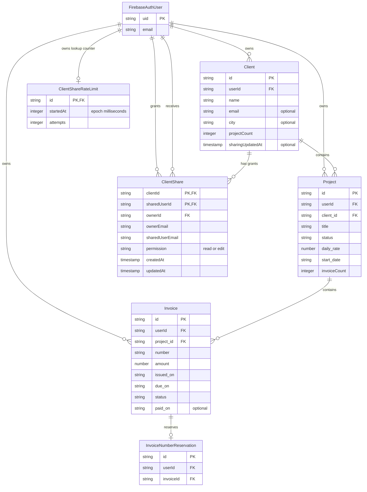

# Schéma de données FreelanceDesk

`FirebaseAuthUser` représente un compte Firebase Authentication. Les identifiants `id` des documents Firestore proviennent de leur chemin. Les dates d’émission, d’échéance et de paiement sont des chaînes au format `AAAA-MM-JJ`. Les horodatages des partages sont des timestamps Firestore.

| Entité | Emplacement réel |
|---|---|
| FirebaseAuthUser | Firebase Authentication |
| Client | `clients/{id}` |
| Project | `projects/{id}` |
| Invoice | `invoices/{id}` |
| ClientShare | `client_shares/{clientId}/client_share_members/{sharedUserId}` |
| InvoiceNumberReservation | `invoiceNumberReservations/{id}` |
| ClientShareRateLimit | `client_share_rate_limits/{ownerId}` |

Le segment `client_shares/{clientId}` sert de chemin parent. Les documents d’autorisation résident dans la sous-collection. Le chemin complet est unique par couple client et associé. Le quota concerne l’UID du propriétaire et toutes les recherches par e-mail sur ses clients. Le numéro de facture est unique par propriétaire.
